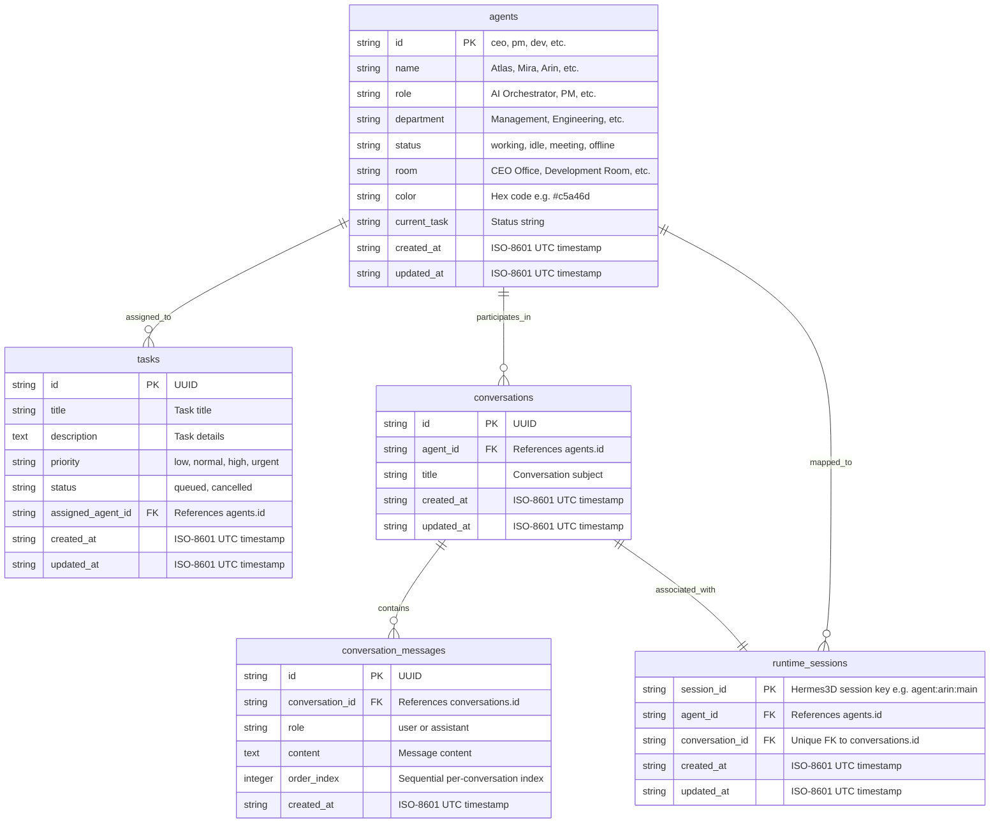

# AgentHQ Database Architecture

**Status:** Production Ready  
**Version:** 2.0 (Phase 2A)  
**Layer:** Authoritative Relational Persistence  
**Dialects Supported:** SQLite 3.x (Local Development) & Neon PostgreSQL 16+ (Cloud Production)  

---

## 1. Dual-Database Architecture Overview

AgentHQ employs a **dual-database architecture** designed to provide zero-configuration, offline development on developer machines while seamlessly scaling to a serverless PostgreSQL instance (Neon) in cloud deployments:

```mermaid
flowchart TD
    App[FastAPI Application Lifecycle] --> GetURL[get_database_url()]
    
    GetURL --> CheckEnv{DATABASE_URL configured?}
    CheckEnv -->|Yes: postgresql://...| Normalize[normalize_database_url()\nConvert to postgresql+psycopg://]
    CheckEnv -->|No: Unset/Empty| SQLitePath[database_path()\nResolve AGENTHQ_DB_PATH]
    
    Normalize --> NeonEngine[PostgreSQL Engine\nDialect: psycopg 3\nPool: Bounded QueuePool\npool_size=5, max_overflow=2\npool_pre_ping=True, pool_recycle=300s]
    SQLitePath --> SQLiteEngine[SQLite Engine\nDialect: pysqlite\nPool: NullPool (Windows-safe)\nPRAGMA foreign_keys=ON\nPRAGMA journal_mode=WAL]
    
    NeonEngine --> SessionFactory[SQLAlchemy 2.0 get_session()]
    SQLiteEngine --> SessionFactory
    SessionFactory --> Models[(Relational Schema\nagents\ntasks\nconversations\nconversation_messages\nruntime_sessions)]
```

### Environment-Based Engine Selection
* **Cloud Mode (PostgreSQL):** Triggered whenever `DATABASE_URL` is set in the environment. Automatically normalizes legacy prefixes (`postgres://` -> `postgresql+psycopg://`).
* **Local Mode (SQLite):** Active whenever `DATABASE_URL` is absent. Resolves database path from `AGENTHQ_DB_PATH` or defaults to `backend/data/agenthq.db`.

---

## 2. Connection Management & Pooling Strategy

### 2.1 Neon Serverless PostgreSQL (`QueuePool`)
Neon operates on a serverless compute model that automatically scales compute to zero after 5 minutes of idle time. To prevent connection exhaustion and stale connection crashes:
* **Driver:** `psycopg 3` (modern binary wheel `psycopg[binary]`).
* **Pool Size:** `5` connections (configured via `DB_POOL_SIZE`).
* **Max Overflow:** `2` connections (configured via `DB_MAX_OVERFLOW`).
* **Connection Pre-Ping (`pool_pre_ping=True`):** Tests connection health before yielding from the pool, preventing disconnect errors when Neon wakes from standby.
* **Pool Recycle (`pool_recycle=300`):** Recycles pooled connections every 5 minutes to align with Neon's idle suspension window.
* **SSL Mode:** Enforces `sslmode=require` in production connection strings.

### 2.2 Local SQLite (`NullPool` & Event Hooks)
* **Pool Class:** `NullPool` is explicitly used for SQLite. This prevents file locking issues on Windows host machines, ensuring database files can be cleanly accessed, backed up, or cleaned up during testing.
* **Dialect-Specific Event Listeners:**
  ```python
  @event.listens_for(engine, "connect")
  def set_sqlite_pragma(dbapi_connection, connection_record):
      if engine.dialect.name == "sqlite":
          cursor = dbapi_connection.cursor()
          cursor.execute("PRAGMA foreign_keys = ON")
          cursor.execute("PRAGMA journal_mode = WAL")
          cursor.close()
  ```
  *Note:* SQLite PRAGMAs are strictly sandboxed inside `engine.dialect.name == "sqlite"` and are **never** executed against PostgreSQL.

---

## 3. Relational Schema & Entity Specifications

The database schema models all foundational entities required for autonomous AI office collaboration:



### 3.1 Eliminating the SQLite `rowid` Dependency
In previous iterations, conversation message retrieval relied on SQLite's internal hidden column:  
`ORDER BY created_at DESC, rowid DESC`

Because **PostgreSQL does not possess a `rowid`**, running this query on PostgreSQL resulted in `UndefinedColumn: column "rowid" does not exist`.

**The Solution:**
AgentHQ introduces an explicit integer column `order_index` on `conversation_messages`:
1. When a new message is inserted, its `order_index` is assigned as `MAX(order_index) + 1` for that specific `conversation_id`.
2. Queries retrieve messages using deterministic ordering:
   ```sql
   SELECT ... FROM (
       SELECT * FROM conversation_messages
       WHERE conversation_id = :cid
       ORDER BY created_at DESC, order_index DESC, id DESC
       LIMIT :limit
   ) ORDER BY created_at ASC, order_index ASC, id ASC;
   ```
3. Even if multiple messages share the exact same timestamp string down to the second, chronological message ordering is 100% deterministic and portable across all SQL engines.

---

## 4. Canonical Employee Seeding & Customization Preservation

AgentHQ initializes with 7 canonical founding AI employees:
1. **Atlas** (`id: ceo`): AI Orchestrator (Management, `#c5a46d`, CEO Office)
2. **Mira** (`id: pm`): Project Manager (Management, `#73a9a1`, Development Room)
3. **Arin** (`id: dev`): Software Engineer (Engineering, `#8c9bc8`, Development Room)
4. **Kiran** (`id: kiran`): Software Engineer (Engineering, `#7d8cbc`, Development Room)
5. **Nia** (`id: design`): UI/UX Designer (Design, `#c28ca8`, Design Studio)
6. **Ira** (`id: research`): Research Analyst (Research, `#89a98b`, Research Room)
7. **Dev** (`id: qa`): QA Engineer (Quality & Testing, `#d69a70`, Meeting Room)

### Idempotency Guarantee
The seeding routine `seed_agents()` checks `session.get(Agent, agent_id)`. If an employee record already exists, it is **never overwritten**. This guarantees that user updates to statuses, room assignments, current tasks, or colors persist across application restarts and Alembic migrations.

