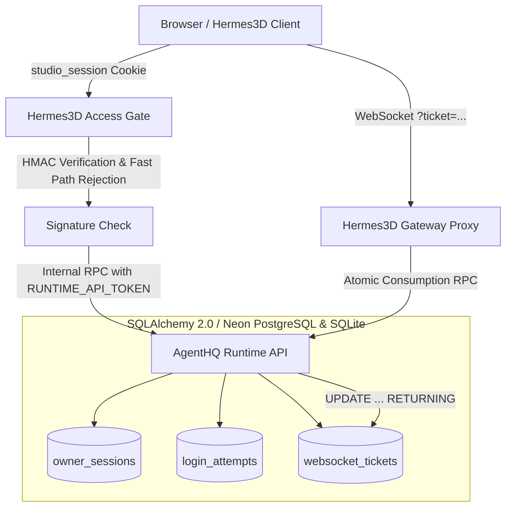

# Phase 2D.1: Persistent Security State Architecture

**Role:** Principal Security Engineer and Distributed Systems Architect  
**Project:** AgentHQ & Hermes3D Cloud Readiness  
**Phase:** 2D.1 — Persistent Security State Migration  
**Target Environments:** Local Development (SQLite 3.50+ WAL) & Production Cloud (Neon PostgreSQL)  

---

## 1. Executive Summary

In Phase 2C, founder authentication, cookie session signing, and single-use WebSocket tickets were introduced. However, security-critical state (active sessions, session revocations, login lockout counters, and WebSocket ticket consumption) was held in Python process memory dictionaries. In a distributed multi-worker deployment or following server restarts on cloud hosts (such as Render), process memory is cleared, introducing serious vulnerabilities:

1. **Lost Revocations:** Logged-out or revoked sessions would immediately become valid again after a container restart if the HMAC signature was still within the 24-hour expiration window.
2. **Rate Limit Evasion:** An attacker could bypass IP-based login lockouts across multiple backend processes or by triggering container recycles.
3. **WebSocket Ticket Replay:** A ticket consumed in process A could be replayed against process B if each worker kept an independent in-memory set.

**Phase 2D.1 moves all security-critical state into the persistent database (Neon PostgreSQL in cloud, SQLite locally)**, establishing AgentHQ as the single authoritative security source of truth.



---

## 2. Persistent Security Entities

Alembic migration `0003_persistent_security_state.py` defines three primary entities:

### 2.1. `owner_sessions`
Stores authoritative server-side session metadata without storing raw cookies or secrets.

| Column | Type | Constraints | Description |
| :--- | :--- | :--- | :--- |
| `id` | VARCHAR(64) | PRIMARY KEY | Random UUID session identifier. |
| `session_token_hash` | VARCHAR(64) | UNIQUE, INDEX, NOT NULL | SHA-256 hash of the complete signed token. |
| `username` | VARCHAR(120) | INDEX, NOT NULL | Founder username. |
| `role` | VARCHAR(32) | NOT NULL, DEFAULT 'founder' | Role for authorization. |
| `csrf_token_hash` | VARCHAR(64) | NOT NULL | SHA-256 hash of the session's CSRF secret. |
| `ip_address` | VARCHAR(45) | NULLABLE | Client IP at session creation. |
| `user_agent` | VARCHAR(255) | NULLABLE | Truncated User-Agent header string. |
| `created_at` | VARCHAR(40) | NOT NULL | ISO-8601 UTC creation timestamp. |
| `expires_at` | BIGINT | INDEX, NOT NULL | Epoch seconds timestamp of expiration. |
| `is_revoked` | BOOLEAN | INDEX, NOT NULL, DEFAULT 0 | Persistent revocation flag. |
| `revoked_at` | VARCHAR(40) | NULLABLE | ISO-8601 UTC revocation timestamp. |
| `last_seen_at` | VARCHAR(40) | NULLABLE | ISO-8601 UTC last request timestamp. |

### 2.2. `login_attempts`
Tracks login failures for persistent rate-limiting across processes.

| Column | Type | Constraints | Description |
| :--- | :--- | :--- | :--- |
| `id` | VARCHAR(64) | PRIMARY KEY | Random UUID identifier. |
| `ip_address` | VARCHAR(45) | INDEX, NOT NULL | Resolved client IP address. |
| `username` | VARCHAR(120) | NULLABLE | Attempted username. |
| `attempt_time` | BIGINT | INDEX, NOT NULL | Epoch seconds timestamp of attempt. |
| `success` | BOOLEAN | NOT NULL, DEFAULT 0 | True if login succeeded; False if failed. |
| `created_at` | VARCHAR(40) | NOT NULL | ISO-8601 UTC timestamp. |

*Composite Index:* `(ip_address, attempt_time)` enables fast window count queries:
```sql
SELECT COUNT(*) FROM login_attempts
WHERE ip_address = :ip AND success = FALSE AND attempt_time >= :window_start;
```

### 2.3. `websocket_tickets`
Tracks durable single-use tickets for WebSockets (`/api/gateway/ws` and `/ws/office`).

| Column | Type | Constraints | Description |
| :--- | :--- | :--- | :--- |
| `id` | VARCHAR(64) | PRIMARY KEY | Random UUID ticket identifier. |
| `ticket_hash` | VARCHAR(64) | UNIQUE, INDEX, NOT NULL | SHA-256 hash of the complete signed ticket string. |
| `username` | VARCHAR(120) | NOT NULL | Authenticated user requesting connection. |
| `created_at` | VARCHAR(40) | NOT NULL | ISO-8601 UTC timestamp. |
| `expires_at` | BIGINT | INDEX, NOT NULL | Epoch seconds timestamp (60s TTL). |
| `is_consumed` | BOOLEAN | INDEX, NOT NULL, DEFAULT 0 | Single-use consumption flag. |
| `consumed_at` | VARCHAR(40) | NULLABLE | ISO-8601 UTC consumption timestamp. |

---

## 3. Cryptographic Storage & Zero Secret Exposure

To prevent catastrophic credential compromise in the event of database dumps or read-only SQL injection:
- **No Raw Cookies:** Plain cookie strings are never stored. The database stores `session_token_hash = sha256(signed_token)`.
- **No Raw CSRF Tokens:** Stored as `csrf_token_hash = sha256(csrf_token)`. Validated by computing SHA-256 of the incoming header.
- **No Raw Tickets:** Plain ticket strings are never stored. The database stores `ticket_hash = sha256(ticket_string)`.
- **No Passwords:** Passwords are never stored in the database. Founder credentials are verified in constant time using configured Argon2id hashes in environment secrets.
- **No API Tokens:** `RUNTIME_API_TOKEN` and `CLOUDFLARE_API_TOKEN` remain strictly in server environment variables and are never persisted to disk or tables.

---

## 4. Concurrency & Atomic Single-Use Consumption

To guarantee that concurrent requests across multiple workers or processes cannot race or replay tickets:

```python
stmt = (
    update(WebSocketTicket)
    .where(
        WebSocketTicket.ticket_hash == ticket_hash,
        WebSocketTicket.is_consumed.is_(False),
        WebSocketTicket.expires_at >= now_epoch,
    )
    .values(is_consumed=True, consumed_at=now_iso)
    .returning(WebSocketTicket.id, WebSocketTicket.username)
)
row = session.execute(stmt).first()
```

- **Atomicity:** The row transition from `is_consumed = FALSE` to `is_consumed = TRUE` is conditional and atomic at the database level.
- **Dialect Portability:** Supported natively on SQLite 3.35+ and PostgreSQL. A fallback transactional update with rowcount verification is provided for any older dialect.
- **Replay Protection:** If multiple processes attempt to consume the identical ticket concurrently, exactly one will update the row and obtain `rowcount = 1`. All subsequent or racing callers receive `None` and are rejected with HTTP 403: `"Ticket already used"`.

---

## 5. Hermes3D Server-to-Server Integration

Hermes3D server acts as the primary access gate and proxies internal authentication requests to AgentHQ:

1. **Founder Login:** Hermes3D verifies founder password against Argon2id hash. Upon success, it calls AgentHQ `POST /api/auth/internal/register-session` with `Authorization: Bearer <RUNTIME_API_TOKEN>` to record the active session in the database.
2. **Founder Logout:** Hermes3D calls AgentHQ `POST /api/auth/internal/revoke-session` with `session_id`, permanently setting `is_revoked = TRUE` in the database.
3. **WebSocket Ticket Generation:** Hermes3D registers the ticket hash with AgentHQ `POST /api/auth/internal/register-ticket`.
4. **WebSocket Connection Upgrade:** Hermes3D calls AgentHQ `POST /api/auth/ws-ticket/consume` before authorizing the upgrade on `/api/gateway/ws`.
5. **No Token Exposure:** The browser client is only issued the HttpOnly `studio_session` cookie; the `RUNTIME_API_TOKEN` is strictly kept on the server.

---

## 6. Resource Management & Maintenance Operations

### Connection Pool Configuration
- **Neon PostgreSQL:** Bounded `QueuePool(pool_size=5, max_overflow=2, pool_timeout=30, pool_recycle=300)`. Short-lived transactional sessions ensure connections are closed promptly (`expire_on_commit=False`).
- **SQLite:** `NullPool` with WAL mode (`PRAGMA journal_mode = WAL`, `PRAGMA busy_timeout = 30000`).

### Automated Pruning
An endpoint `POST /api/auth/cleanup` (invoked periodically or via admin cron) executes:
```sql
DELETE FROM websocket_tickets WHERE expires_at < :cutoff;
DELETE FROM login_attempts WHERE attempt_time < :cutoff;
DELETE FROM owner_sessions WHERE expires_at < :cutoff OR (is_revoked = TRUE AND expires_at < :now);
```
All deletions run within a single transaction, keeping database disk usage minimal under free-tier storage limits.

