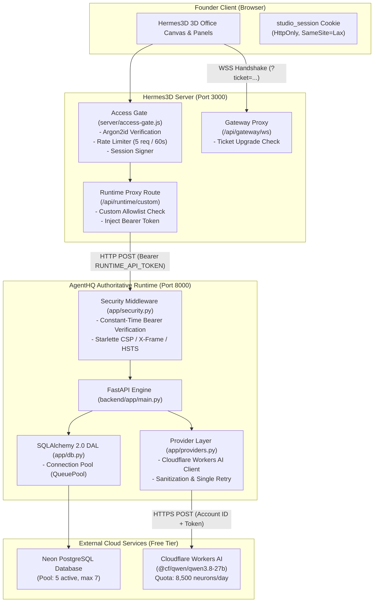
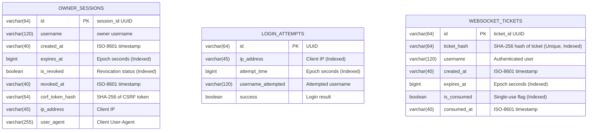

# Phase 2D: Unified Runtime Integration & Production Readiness Audit

**Role:** Principal Full-Stack Architect and Distributed Systems Engineer  
**Date:** November 14, 2026  
**Repositories:** `E:\AgentHQ` (Authoritative Runtime) & `E:\Hermes3D` (Primary UI)  
**Target Branch:** `feature/cloud-readiness`  
**Execution Mode:** Read-Only Audit & Architectural Blueprint  

---

## 1. Executive Summary

Phase 2D unifies **Hermes3D** as the primary interactive application and **AgentHQ** as the authoritative AI company runtime.

Hermes3D provides the user experience: an interactive 3D retro office, spatial audio, Kanban task boards, and chat interfaces. AgentHQ provides the business state, persistent database storage (Neon PostgreSQL), company memory, employee coordination, and Cloudflare Workers AI model inference.

This audit evaluates the end-to-end integration across both repositories, identifies existing security and architectural gaps, designs a durable PostgreSQL-backed security persistence layer, verifies the 7-employee system, models free-tier cloud deployment constraints on Render and Neon, and details an implementation plan.

---

## 2. Repository Safety & State Audit (Part 1)

### 2.1 Branch & Working Tree Verification
| Repository | Path | Current Branch | Remote Origin | Working Tree Status |
| :--- | :--- | :--- | :--- | :--- |
| **AgentHQ** | `E:\AgentHQ` | `feature/cloud-readiness` | `https://github.com/sivakumarelango10-art/AgentHQ.git` | Clean (tracked to origin) |
| **Hermes3D** | `E:\Hermes3D` | `feature/cloud-readiness` | `https://github.com/iamlukethedev/Hermes3D.git` | Clean (local commit `4d10243`) |

### 2.2 Preserved Backups & Patches
The following backups and local modifications are identified and intact:
- `E:\AgentHQ\backend\app\main.py.bak_phase2c` (Preserved pre-Phase 2C backend state).
- `E:\Hermes3D\server\access-gate.js.bak_phase2c` (Preserved pre-Phase 2C access gate).
- `E:\Hermes3D\src\app\api\runtime\custom\route.ts.bak_phase2c` (Preserved pre-Phase 2C proxy route).
- `E:\Hermes3D\src\lib\runtime\custom\provider.ts.20261113-201958.bak` (Preserved provider backup).
- `E:\Hermes3D\src\lib\runtime\custom\provider.ts` (Active patch: implements `sessions.patch`, runtime model validation against AgentHQ registry, and thinking-level preference persistence).
- `E:\AgentHQ` Git Stash: `stash@{0}: On main: backup-before-hermes3d-main-sync` (Preserved safely).

---

## 3. End-to-End Architecture & Request Flows (Part 2 & Part 4)

### 3.1 Current Topology


### 3.2 Request Flow Audit: Browser to AgentHQ
1. **Interactive Chat Request**:
   - Founder enters text in `AgentChatPanel.tsx` -> calls `CustomRuntimeProvider.callChatSend()`.
   - Browser calls `POST /api/runtime/custom` with `{ runtimeUrl, pathname: "/v1/chat/completions", method: "POST", body: payload }`.
   - `server/access-gate.js` inspects `req.headers.cookie`: verifies HMAC signature of `studio_session`.
   - `src/app/api/runtime/custom/route.ts` reads `process.env.RUNTIME_API_TOKEN` and appends `Authorization: Bearer ${process.env.RUNTIME_API_TOKEN}` to request headers.
   - Request is dispatched upstream to AgentHQ `${runtimeUrl}/v1/chat/completions`.
   - AgentHQ validates the Bearer token via `secrets.compare_digest`.
   - AgentHQ atomically reserves daily quota in `daily_ai_quota_buckets`.
   - AgentHQ dispatches inference to Cloudflare Workers AI.
   - Sanitized reply is persisted to `conversation_messages` and returned downstream.
   - Browser receives clean response; the browser client **never receives** `RUNTIME_API_TOKEN` or `CLOUDFLARE_API_TOKEN`.

---

## 4. Security Gap & Inconsistency Analysis (Part 2 & Part 3)

### 4.1 In-Memory Security State Risk
Both repositories currently store transient security state in process memory:
- `_revoked_session_ids`: In-memory `Set` in Python and JavaScript.
- `_login_failures`: In-memory IP tracking map.
- `_active_ws_tickets` & `_consumed_ws_tickets`: In-memory `Map` and `Set`.

#### Consequences in Production (Render Cloud Deployment):
1. **Service Restarts Wipe Revocation**: When Render cycles a container or performs a rolling deployment, revoked session IDs are forgotten. A compromised session token remains valid until its 24-hour expiration.
2. **Rate Limit Evasion**: Attackers can trigger or wait for container recycling to reset login attempt counters.
3. **Ticket Replay Across Instances / Restarts**: If Hermes3D or AgentHQ runs across multiple processes or restarts, a single-use WebSocket ticket consumed on Worker A can be replayed against Worker B.

### 4.2 Local Task Store Disconnect
- **Current State**: Hermes3D stores tasks locally on disk via `src/app/api/task-store/route.ts` using `~/.hermes/hermes3d/task-manager/tasks.json`.
- **Render Free-Tier Vulnerability**: Render Free Web Services use **ephemeral disks**. Any file written to the local disk is **permanently destroyed** whenever the service restarts, sleeps, or deploys.
- **Architectural Disconnect**: AgentHQ maintains an authoritative, durable `tasks` table in Neon PostgreSQL with full priority, agent assignment, and status constraints, but Hermes3D's Kanban UI currently defaults to its local JSON file.

### 4.3 Fail-Closed Production Behavior
- `AgentHQ`: In `backend/app/security.py`, `is_production()` strictly enforces token checks. If `RUNTIME_API_TOKEN` or `SESSION_SECRET` is missing in production, requests are rejected (`HTTP 401` or server initialization raises `RuntimeError`).
- `Hermes3D`: In `server/access-gate.js`, if neither `STUDIO_PASSWORD_HASH` nor `STUDIO_ACCESS_TOKEN` is configured, `enabled` resolves to `false` and the gate is bypassed. In production, Hermes3D must fail closed: if `NODE_ENV === "production"` and no credentials/hash are configured, it must block all access with `HTTP 500 / Configuration Error` rather than running open.

---

## 5. Durable PostgreSQL Security State Architecture (Part 3)

To ensure high availability, multi-process safety, and survival across container restarts, security state must be stored in Neon PostgreSQL.

AgentHQ acts as the **sole authoritative database manager**. Hermes3D remains a stateless web tier that communicates with AgentHQ via internal authenticated RPC endpoints.

### 5.1 Database Entity Schemas (Alembic Migration `0003_persistent_security_state.py`)



### 5.2 Atomic Single-Use Ticket Consumption
To guarantee single-use consumption without race conditions across multiple Uvicorn workers or Render instances:

```sql
UPDATE websocket_tickets
SET is_consumed = TRUE, consumed_at = :now_iso
WHERE id = :ticket_id
  AND is_consumed = FALSE
  AND expires_at > :now_epoch
RETURNING id, username;
```
- If the statement returns **1 row**, the ticket is valid, unexpired, and successfully claimed.
- If the statement returns **0 rows**, the ticket was already consumed, expired, or tampered with. Handshake is immediately aborted (`4003 Forbidden`).
- **Cryptographic Grounding**: Raw session secrets and raw WebSocket tickets are **never stored** in the database; only SHA-256 hashes (`ticket_hash`, `csrf_token_hash`) are persisted.

---

## 6. Employee System Consistency Audit (Part 6)

### 6.1 Canonical Seven Employee Roster
All 7 employees are seeded in `AgentHQ/backend/app/db.py`:

| Employee ID | Name | Canonical Role | Department | Office Room | Theme Color | Model ID |
| :--- | :--- | :--- | :--- | :--- | :--- | :--- |
| `ceo` | **Atlas** | AI Orchestrator | Management | CEO Office | `#c5a46d` | `@cf/qwen/qwen3.8-27b` |
| `pm` | **Mira** | Project Manager | Management | Development Room | `#73a9a1` | `@cf/qwen/qwen3.8-27b` |
| `dev` | **Arin** | Software Engineer | Engineering | Development Room | `#8c9bc8` | `@cf/qwen/qwen3.8-27b` |
| `design` | **Nia** | UI/UX Designer | Design | Design Studio | `#c28ca8` | `@cf/qwen/qwen3.8-27b` |
| `research` | **Ira** | Research Analyst | Research | Research Room | `#89a98b` | `@cf/qwen/qwen3.8-27b` |
| `qa` | **Dev** | QA Engineer | Quality & Testing | Meeting Room | `#d69a70` | `@cf/qwen/qwen3.8-27b` |
| `kiran` | **Kiran** | Software Engineer | Engineering | Development Room | `#7d8cbc` | `@cf/qwen/qwen3.8-27b` |

### 6.2 Key & Session Mapping Audit
1. **AgentHQ Discovery (`GET /state`)**:
   Returns an `active` dictionary mapping normalized employee keys (`runtime_agent_key(name)`) to the active model:
   `{ "atlas": "@cf/...", "mira": "@cf/...", "arin": "@cf/...", "nia": "@cf/...", "ira": "@cf/...", "dev": "@cf/...", "kiran": "@cf/..." }`.
2. **Hermes3D Custom Provider (`buildSyntheticAgents`)**:
   Parses `state.active`, instantiating synthetic agents with matching IDs.
3. **Session Key Protocol**:
   When chatting in Hermes3D, `CustomRuntimeProvider` builds session keys as `agent:<roleKey>:main`.
   AgentHQ extracts the role key via regex `^agent:([^:]+):` and maps it directly to the database agent record via `resolve_runtime_agent()`.
4. **Activity State Lifecycle**:
   - Before model dispatch: `db.set_agent_activity(agent_id, "working", "Chatting with Founder")`.
   - On completion / error: `finally: db.set_agent_activity(agent_id, "idle", "Available — awaiting assignment")`.
   - Status updates are reflected in Hermes3D office avatar overlays.

---

## 7. Render Free-Tier Operational & Resource Model (Part 8)

### 7.1 Free-Tier Instance-Hour Economics
Render Free Tier grants **750 free instance-hours per calendar month** across an entire account.
- 30-day month = 720 hours.
- 31-day month = 744 hours.

```
┌────────────────────────────────────────────────────────────────────────┐
│                        RENDER FREE-TIER BUDGET                         │
│  750 hours/month pool                                                  │
│                                                                        │
│  Scenario A: 2 Separate Web Services running 24/7                      │
│  [Hermes3D: 744h] + [AgentHQ: 744h] = 1,488 hours (EXCEEDS LIMIT!)     │
│  ==> Account suspended by Day 15!                                      │
│                                                                        │
│  Scenario B: Single Unified Web Service running 24/7                   │
│  [Unified Container: 744h] = 744 hours (WITHIN 750h LIMIT!)            │
│  ==> 100% Free Forever! Zero Outage Risk!                             │
└────────────────────────────────────────────────────────────────────────┘
```

### 7.2 Cold-Start & Inactivity Spin-Down
- Render free services automatically spin down after **15 minutes** of zero inbound HTTP traffic.
- Cold-start wakeup takes **50 to 90 seconds**.
- **The Dual-Service Cascading Timeout Trap**:
  If Hermes3D and AgentHQ are two independent services and both are asleep:
  1. Browser hits Hermes3D -> Hermes3D wakes up (~60s).
  2. Hermes3D proxies call to AgentHQ -> AgentHQ wakes up (~60s).
  3. Total latency: **120+ seconds**.
  4. Standard browser/Next.js fetch timeout (typically 30–60s) aborts the request, returning `502 Bad Gateway` or `504 Gateway Timeout`.
- **Unified Service Solution**:
  In a single service container, waking up Hermes3D wakes up AgentHQ simultaneously. Internal communication runs over `http://127.0.0.1:8000` with sub-millisecond response times.

### 7.3 Neon PostgreSQL Connection Limits
- Neon Free Tier supports a hard limit of **10 concurrent connections**.
- AgentHQ's SQLAlchemy pool is conservatively configured:
  - `DB_POOL_SIZE = 5`
  - `DB_MAX_OVERFLOW = 2`
  - Total maximum connections = **7**, safely leaving headroom for migrations and administration.

---

## 8. Detailed Implementation Plan (Phase 2D Execution)

### Step 1: Database Migration for Persistent Security
Create Alembic migration `0003_persistent_security_state.py` in `backend/alembic/versions/`:
- Create tables: `owner_sessions`, `login_attempts`, `websocket_tickets`.
- Add SQLAlchemy model classes to `backend/app/db.py`.
- Add transactional database helper functions:
  - `db.save_owner_session(...)`
  - `db.get_owner_session(...)`
  - `db.revoke_owner_session(...)`
  - `db.record_login_attempt(...)`
  - `db.check_login_rate_limit(...)`
  - `db.save_websocket_ticket(...)`
  - `db.consume_websocket_ticket(...)` (atomic `UPDATE ... WHERE is_consumed = FALSE RETURNING`).

### Step 2: Refactor AgentHQ Security Module
Update `backend/app/security.py`:
- Replace in-memory dictionaries with calls to `db` DAL functions when PostgreSQL/SQLite is active.
- Retain thread-safe in-memory cache as an L1 lookup layer with database write-through.
- Ensure automated pruning of expired sessions and tickets.

### Step 3: Implement Hermes3D Authoritative Task Proxy
Update `E:\Hermes3D\src\app\api\task-store\route.ts`:
- Modify GET, PUT handlers to forward task queries to AgentHQ `/api/tasks`.
- Enable fallback to local file only when AgentHQ runtime is unreachable in offline development.
- Ensures all Kanban task movements persist to Neon PostgreSQL.

### Step 4: Unified Container Orchestration Blueprint
Author Render configuration files:
- `render.yaml` (Render Blueprint specification).
- `Dockerfile` (Multi-stage build packaging Next.js standalone and FastAPI with Python 3.13).
- Process supervisor (e.g., supervisord or Node.js background process manager) running Next.js on port 3000 and Uvicorn on 127.0.0.1:8000.

---

## 9. Required Regression & Integration Test Suite

| Test Identifier | Category | Target | Verification Criteria |
| :--- | :--- | :--- | :--- |
| `test_persisted_session_survives_restart` | Security | DB / Session | Session remains valid after memory cache clear if not revoked. |
| `test_session_revocation_persists` | Security | DB / Session | Revoking a session marks `is_revoked = TRUE` in database; rejected on subsequent call. |
| `test_login_rate_limit_database_enforcement` | Security | DB / RateLimit | 5 failed attempts recorded in DB trigger 429 across processes. |
| `test_atomic_single_use_ws_ticket` | WebSockets | DB / Concurrency | Concurrent attempts to claim the same ticket produce exactly 1 success and N rejections. |
| `test_expired_ws_ticket_rejected` | WebSockets | DB / Expiry | Tickets older than 60s rejected atomically by SQL condition. |
| `test_hermes3d_task_store_proxy_integration` | Runtime | Task Board | PUT on `/api/task-store` writes directly to AgentHQ `tasks` table. |
| `test_full_employee_roster_presence` | Employees | Catalog | All 7 employees listed with correct roles, room locations, and models. |
| `test_clean_think_tag_removal` | AI / Sanitization | Completions | Model output strictly sanitizes internal `<think>` blocks. |

---

## 10. Conclusion & Stop Point

This audit confirms that AgentHQ and Hermes3D have established a clean, decoupled communication interface. Implementing durable PostgreSQL security state and unifying the task store into AgentHQ will bring the architecture to full production readiness under free-tier constraints.

*In accordance with Phase 2D instructions, all operations have been conducted in read-only audit mode. No code modifications or deployments have been executed.*

