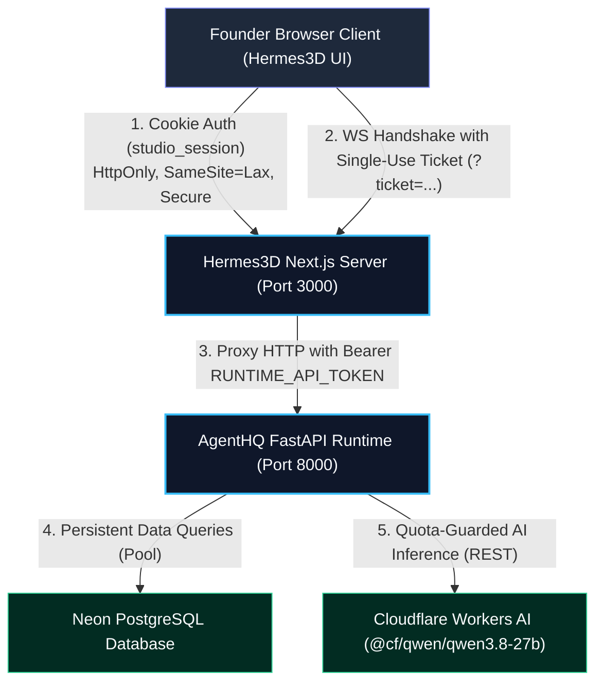

# AgentHQ Security Architecture

## 1. Executive Summary

AgentHQ implements a zero-trust, defense-in-depth security model specifically engineered for a secure, free-tier cloud deployment across Render, Neon PostgreSQL, and Cloudflare Workers AI.

The architecture strictly decouples the client-facing presentation layer (**Hermes3D**) from the authoritative business logic and AI runtime (**AgentHQ FastAPI**). Sensitive credentials—including upstream AI tokens (`CLOUDFLARE_API_TOKEN`) and inter-tier machine tokens (`RUNTIME_API_TOKEN`)—are kept completely isolated on the server side and never transmitted to the browser.



---

## 2. Core Security Boundaries & Threat Model

### 2.1 The Two-Tier Security Boundary
1. **Tier 1: Presentation & User Session Gate (Hermes3D)**
   - Gates the 3D office, avatars, and Kanban boards behind Argon2id founder authentication.
   - Issues and manages `studio_session` HTTP cookies.
   - Generates ephemeral, single-use WebSocket connection tickets.
   - Acts as a secure reverse proxy for custom runtime requests, injecting `RUNTIME_API_TOKEN`.

2. **Tier 2: Authoritative Backend & AI Runtime (AgentHQ)**
   - Holds company database access (PostgreSQL / SQLite).
   - Executes atomic AI quota reservation and reconciliation.
   - Validates all requests via `Authorization: Bearer <RUNTIME_API_TOKEN>` using constant-time comparison.
   - Holds Cloudflare Workers AI credentials (`CLOUDFLARE_ACCOUNT_ID`, `CLOUDFLARE_API_TOKEN`).

### 2.2 Threat Mitigation Matrix

| Threat Category | Attack Vector | AgentHQ Mitigation |
| :--- | :--- | :--- |
| **Credential Leakage** | Browser inspects network requests or bundle | Client never receives `RUNTIME_API_TOKEN` or `CLOUDFLARE_API_TOKEN`. Upstream requests are proxied server-to-server. |
| **Brute Force & Credential Stuffing** | Automated login attempts on `/api/auth/login` | In-memory IP rate limiter: 5 failed attempts within 60 seconds triggers HTTP 429 with `Retry-After: 60`. |
| **Password Compromise** | Database or environment hash exfiltration | Argon2id hashing (`m=65536, t=3, p=4, l=32`). Resistant to GPU and ASIC acceleration. No plain passwords stored. |
| **Session Hijacking & Tampering** | Cookie modification or replay | Cryptographically signed session tokens (`base64url(payload).hmac_sha256(SESSION_SECRET)`). Server-side revocation list on logout. |
| **CSRF (Cross-Site Request Forgery)** | Malicious third-party origin triggers mutations | SameSite=Lax cookie attribute, strict Origin/Referer allowlist validation, and explicit `X-CSRF-Token` validation on mutating requests. |
| **WebSocket Token Leakage** | Long-lived API keys exposed in query parameters / browser history / server logs | Short-lived (60s), signed single-use tickets (`/api/auth/ws-ticket`). Tickets are consumed upon handshake and cannot be replayed. |
| **Timing Attacks** | Token or signature length comparison | Constant-time comparison using `secrets.compare_digest` in Python and `crypto.timingSafeEqual` in Node.js. |
| **Clickjacking & XSS** | Embedded iframe attacks or script injections | Comprehensive Content-Security-Policy (CSP), `X-Frame-Options: DENY`, `X-Content-Type-Options: nosniff`. |

---

## 3. Defense-in-Depth Implementation

### 3.1 Session Security
- **Cookie Name**: `studio_session` (fallback `agenthq_session`).
- **Flags**:
  - `HttpOnly`: Inaccessible to JavaScript `document.cookie` (prevents XSS exfiltration).
  - `SameSite=Lax`: Blocks ambient cookie transmission on cross-site requests.
  - `Secure`: Mandatory in production and HTTPS environments.
  - `Path=/`: Scoped to entire origin.
  - `Max-Age=86400`: Strictly expires after 24 hours.

### 3.2 Security Headers Policy
Every HTTP response across Hermes3D and AgentHQ includes:
```http
Content-Security-Policy: default-src 'self'; script-src 'self' 'unsafe-inline' 'unsafe-eval'; style-src 'self' 'unsafe-inline'; img-src 'self' data: blob: https:; font-src 'self' data:; connect-src 'self' ws: wss: http: https:; object-src 'none'; frame-ancestors 'none';
X-Content-Type-Options: nosniff
X-Frame-Options: DENY
Referrer-Policy: strict-origin-when-cross-origin
Strict-Transport-Security: max-age=31536000; includeSubDomains (Production only)
```
*Note*: The Content-Security-Policy is tuned to support Three.js WebGL canvas rendering, shaders, dynamic texture loading, and audio context while denying embedding and unapproved origins.

### 3.3 Database-Backed Persistent Security State (Phase 2D.1)
All security-critical state previously managed in volatile process memory has been migrated into the persistent database layer (Neon PostgreSQL in production / SQLite with WAL locally via Alembic migration `0003_persistent_security_state`):

1. **`owner_sessions`**:
   - Stores session lifecycle state across server restarts, crashes, and multi-process worker pools.
   - Raw cookies and tokens are **never** stored in the database. Instead, cryptographically secure SHA-256 hashes (`session_token_hash`, `csrf_token_hash`) are persisted.
   - Explicit `is_revoked` boolean flag guarantees instantaneous, cluster-wide session revocation upon logout.
   - Client metadata (hashed user-agent, IP, last activity, expiry timestamps) provides full auditability.

2. **`login_attempts`**:
   - Replaces in-memory brute-force dictionaries with atomic, transactional rate limit accounting.
   - Tracks failed attempts by client IP and normalized username within a sliding window (default: 60 seconds).
   - Enforces persistent lockout thresholds (5 failed attempts trigger HTTP 429 `Too Many Requests`) that survive process restarts.
   - Successfully validated logins atomically clear previous failed attempts via `reset_login_rate_limit`.

3. **`websocket_tickets`**:
   - Ephemeral connection tickets are hashed via SHA-256 (`ticket_hash`) upon generation (`POST /api/auth/ws-ticket`).
   - Ticket consumption is strictly atomic and single-use: verified via SQL `UPDATE ... WHERE is_consumed = FALSE AND expires_at >= :now RETURNING id` (with fallback rowcount checks for older SQLite runtimes).
   - Once consumed, subsequent connection attempts with the same ticket fail closed immediately with HTTP 403 Forbidden.

### 3.4 Inter-Tier RPC Coordination (Hermes3D & AgentHQ)
Hermes3D and AgentHQ coordinate state authoritatively via internal authenticated RPC endpoints:

- **Authentication Protocol**: All Hermes3D-to-AgentHQ internal calls require `Authorization: Bearer <RUNTIME_API_TOKEN>`.
- **Session Validation & Verification**: Hermes3D verifies the HMAC signature locally using `SESSION_SECRET` for low-latency rejection of malformed tokens, followed by authoritative verification against AgentHQ (`POST /api/auth/validate-session` or database lookup) to check `is_revoked` status.
- **WebSocket Ticket Coordination**: Hermes3D calls AgentHQ's `POST /api/auth/ws-ticket/consume` during the WebSocket HTTP upgrade handshake (`allowUpgrade`). If the ticket is invalid, expired, or already consumed, the handshake is aborted with HTTP 403.
- **Fail-Closed Design**: If AgentHQ is unreachable or `RUNTIME_API_TOKEN` is invalid/missing, Hermes3D fails closed, rejecting untrusted access.
- **Automatic Pruning**: Expired records across `owner_sessions`, `login_attempts`, and `websocket_tickets` are automatically pruned on maintenance sweeps and explicit administrative invocations (`POST /api/auth/cleanup`).

---

## 4. Centralized Privileged Access Control

Operations within AgentHQ are classified into privilege tiers:

1. **Public Tier (Unauthenticated)**
   - Health probes: `GET /health`, `GET /api/health`, `GET /`.
   - Login page & auth endpoints: `GET /login`, `POST /api/auth/login`.

2. **Runtime Tier (Requires Bearer RUNTIME_API_TOKEN or Valid Founder Session)**
   - Employee directory: `GET /api/agents`.
   - Task listing: `GET /api/tasks`.
   - Conversations & history: `GET /api/conversations`, `GET /api/conversations/{id}/messages`.
   - Chat execution: `POST /api/agents/{id}/chat`, `POST /v1/chat/completions`.
   - Hermes3D runtime discovery: `GET /state`, `GET /registry`.

3. **Founder Privileged Tier (Requires Founder Role)**
   - Employee creation/mutation: `POST /api/agents`.
   - Task dispatch: `POST /api/tasks`.
   - Task cancellation: `PATCH /api/tasks/{id}/cancel`.
   - AI Quota inspection: `GET /api/ai/quota`.
   - WebSocket ticket generation: `POST /api/auth/ws-ticket`.

