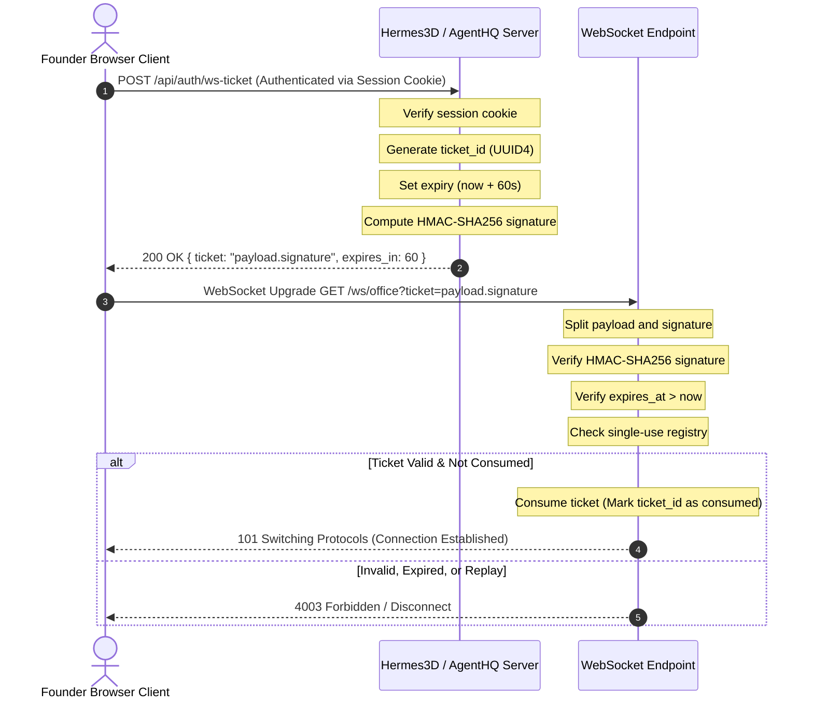

# WebSocket Ticket Security Architecture

## 1. Overview

AgentHQ and Hermes3D utilize WebSockets for low-latency live synchronization:
- Hermes3D gateway adapter: `/api/gateway/ws`
- AgentHQ office events: `/ws/office`

Standard HTTP Authorization headers are not consistently supported by browser WebSocket clients (`new WebSocket(url)` cannot send custom request headers).

Passing long-lived API keys or secrets in URL query parameters (`wss://...?token=SECRET`) creates serious security vulnerabilities:
1. **Server Logs**: Query parameters are saved in plaintext access logs across proxies, load balancers, and CDNs.
2. **Browser History**: Query parameters persist in user browser history and telemetry.
3. **Referer Leakage**: URLs with query parameters may leak via Referer headers to third-party assets.
4. **Token Theft**: Anyone who observes the connection URL gains unrestricted access to the entire runtime.

To solve this, AgentHQ and Hermes3D implement **Ephemeral Signed Single-Use WebSocket Tickets**.

---

## 2. Ticket-Based Authentication Architecture



---

## 3. Ticket Structure & Cryptographic Signing

The ticket consists of two parts separated by a dot:
```
<base64url_encoded_payload>.<hmac_sha256_signature>
```

### 3.1 Payload Structure
```json
{
  "ticket_id": "8f1a7d6e5c4b3a21...",
  "username": "founder",
  "expires_at": 1794639600
}
```

### 3.2 Cryptographic Signature
```python
signature = hmac.new(
    SESSION_SECRET.encode("utf-8"),
    payload_b64.encode("utf-8"),
    hashlib.sha256
).digest()
```

---

## 4. Single-Use and Replay Protection

To prevent replay attacks:
1. When a ticket is issued via `POST /api/auth/ws-ticket`, its `ticket_id` is registered in the active tickets map with its expiration timestamp.
2. When a WebSocket upgrade request arrives with `?ticket=...`:
   - The server verifies the HMAC signature.
   - The server verifies that `now <= expires_at`.
   - The server checks if `ticket_id` is in the `consumed_tickets` set. If present, the connection is **immediately rejected** (replay attempt detected).
   - If not in `consumed_tickets` and present in `active_tickets`, the server removes `ticket_id` from `active_tickets` and adds it to `consumed_tickets`.
3. An attacker intercepting an already-established WebSocket URL cannot reuse the ticket to establish a second connection.

---

## 5. Expiration Policy

- **Ticket Lifetime**: Exactly 60 seconds from issuance.
- **Cleanup**: Expired tickets are pruned lazily on every issuance/verification operation or periodically.
- **Failure Code**: If a ticket has expired, the WebSocket handshake is aborted with status code `4003 Forbidden`.

